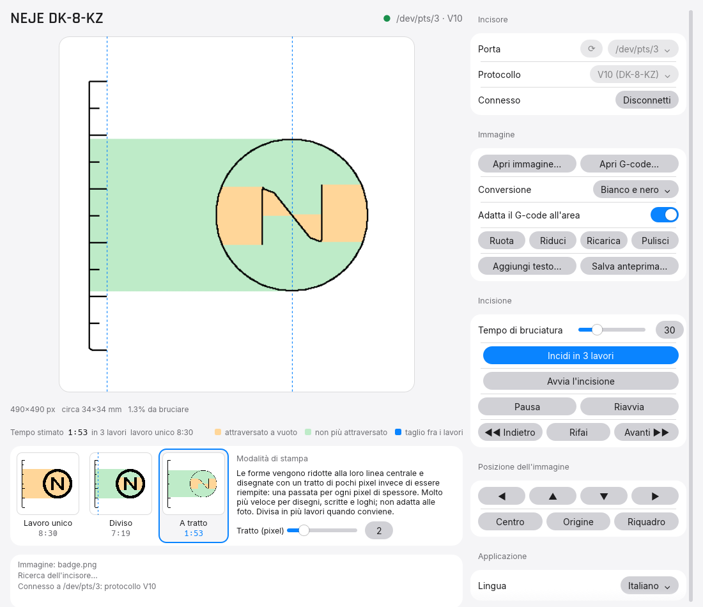
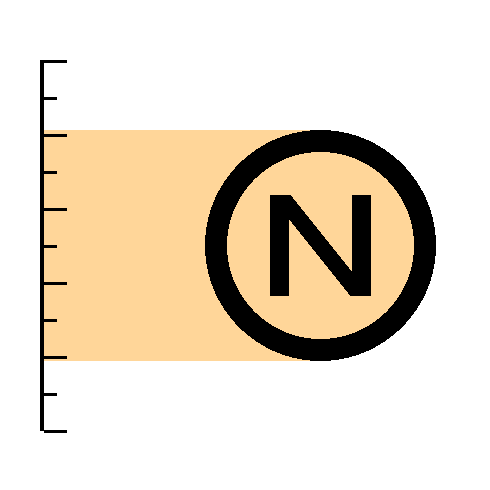
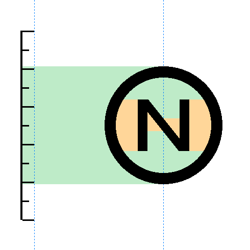
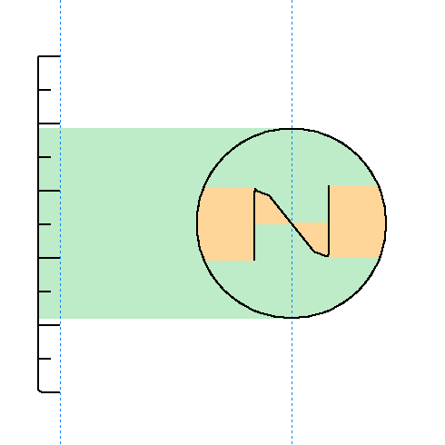

# neje

Software libero per l'incisore laser **NEJE DK-8-KZ**, per Linux (e Windows).
Sostituisce il programma NEJE V3.6, abbandonato e solo per Windows: prepari un'immagine, un
testo o un disegno in G-code, lo invii all'incisore e avvii il lavoro, da una finestra o dal
terminale.

[Read it in English](README.md)



## Stato

| Parte | Stato |
|---|---|
| Preparazione dell'immagine (riduzione, grigio, Otsu, retinatura NEJE, BMP a 1 bit) | stessi byte dell'implementazione di riferimento su oltre 21 000 casi |
| Comandi e messaggi dei protocolli V10, V20, V21, V30 | stessi byte dell'implementazione di riferimento |
| Rilevamento, cancellazione, invio, avvio, avanzamento, fine lavoro | provati con l'incisore virtuale incluso |
| Modalità di stampa (divisione in lavori, a tratto) e stime dei tempi | stessi tagli e stessi tempi dello strumento di riferimento; la divisione è stata provata su una macchina vera con quello strumento (stimati 143 s, impiegati 148 s, le parti combaciano) |
| Una DK-8-KZ vera | **non ancora comandata da questo programma**; stretta di mano e movimenti sono stati provati su una macchina con il prototipo Python da cui deriva (vedi [docs/PROTOCOL.md](docs/PROTOCOL.md)) |
| Windows | la compilazione dovrebbe funzionare, mai provata |

La DK-8-KZ incide 490 × 490 pixel. Il manuale dice 0,075 mm per pixel (36,75 mm); sulla
macchina misurata qui un pixel vale 0,068–0,070 mm, quindi l'area è di circa 34 × 34 mm.

## Sicurezza laser

- Il diodo laser (405 nm) è acceso a bassa potenza **appena colleghi l'alimentatore 5 V**:
  indossa gli occhiali protettivi ogni volta che la macchina è alimentata.
- `start`, `engrave`, `box`, `forward`, `backward` e `redo` accendono il laser. Il programma
  chiede prima una conferma: occhiali indossati, materiale sotto la testa, niente di
  infiammabile vicino. Non lasciare mai un lavoro in corso senza sorveglianza.
- Alimenta l'incisore con un vero **alimentatore 5 V**, non dalle porte USB del computer:
  con entrambi i cavi sul PC la scheda si è riavviata a metà di lavori lunghi. Il programma
  segnala un riavvio del genere come errore, invece di aspettare una fine che non arriva.
- `box` (il riquadro) si ripete finché non mandi `center`.
- `start` incide l'immagine conservata nella macchina, che resta anche da spenta: su una
  macchina appena collegata può essere una vecchia immagine.
- Questo programma non scrive mai nel firmware dell'incisore.

## Installazione

Serve una toolchain Rust (1.88 o successiva). Su Arch/CachyOS non è servito altro per
compilare; la finestra usa OpenGL e le finestre di scelta file del desktop.

```sh
git clone <questo repository>
cd neje-rs
./install.sh            # compila e installa in ~/.local (senza root)
./install.sh --udev     # installa anche la regola udev (chiede la password di sudo)
./install.sh --uninstall
```

Il convertitore USB-seriale dell'incisore (CH340, `1a86:7523`) è gestito dal kernel Linux:
compare come `/dev/ttyUSB0`. Per aprirlo serve la regola udev
([packaging/linux/70-neje.rules](packaging/linux/70-neje.rules), accesso all'utente che ha
la sessione aperta sul computer) oppure l'appartenenza al gruppo proprietario della porta
(`uucp` su Arch, `dialout` su Debian e Ubuntu).

Senza interfaccia grafica: `cargo build --release --no-default-features`.

## Uso

### Finestra

```sh
neje-gui                 # oppure il lanciatore "Incisore NEJE"
neje-gui foto.jpg        # apre subito un'immagine o un file G-code
```

Apri un'immagine (o trascinala sulla finestra), scegli la conversione, connetti, invia
l'immagine e poi avvia. La traccia rossa sull'anteprima segue le posizioni comunicate
dall'incisore. La lingua si cambia in fondo al pannello, nel gruppo "Applicazione".

### Terminale

```sh
neje ports                               # elenca le porte seriali
neje detect                              # trova l'incisore
neje preview foto.jpg -o anteprima.png   # cosa verrebbe inciso, senza macchina
neje preview foto.jpg --mode dither      # retinatura NEJE, per le foto
neje preview --gcode examples/rosette.nc --fit --text "NEJE" --size 40
neje upload foto.jpg                     # cancella la memoria e invia l'immagine
neje engrave foto.jpg --burn 30          # invia e poi incide (chiede conferma)
neje engrave logo.png --print-mode split # più lavori, uno dopo l'altro
neje engrave logo.png --print-mode line --stroke 2
neje start --burn 30                     # incide l'immagine già nella macchina
neje pause                               # anche Ctrl+C durante "engrave" mette in pausa
neje center | home | move left 5 | box | set-burn 40 | monitor
```

`neje --help` e `neje <comando> --help` elencano tutte le opzioni. Le più utili:

- `--port /dev/ttyUSB0`: salta la ricerca (e fa passare `pause`/`reset` anche quando il
  firmware è troppo occupato per rispondere);
- `--protocol v10|v20|v21|v30|auto`: il predefinito è `v10`, il protocollo della DK-8-KZ.
  `auto` li prova tutti come il lanciatore originale; evitalo su una macchina V10;
- `--lang en|it`: lingua dei messaggi (predefinita: quella del sistema).

### Modalità di stampa

Il firmware incide solo riga per riga: in ogni riga la testa va dal primo all'ultimo pixel
nero e attraversa tutto lo spazio vuoto che c'è in mezzo. Non ha un comando "laser acceso" né
un "vai a X, Y", quindi il programma non può disegnare lungo un percorso; può scegliere che
cosa inviare. La modalità si sceglie nella striscia sotto l'anteprima, oppure con
`--print-mode`; `neje preview` stampa il tempo stimato di tutte e tre per la tua immagine.

| | Modalità | Cosa fa |
|---|---|---|
|  | **Lavoro unico** (`single`) 8:30 | L'immagine viene inviata e incisa così com'è, in una volta sola. In arancione: lo spazio vuoto che la testa attraversa a ogni riga. |
|  | **Diviso in lavori** (`split`) 7:19 | L'immagine viene tagliata in fasce verticali (linee blu), incise una dopo l'altra, quando lo spazio vuoto non più attraversato (verde) vale più di un invio in più, circa 12 s. Le fasce combaciano sul pezzo: non riavviare né spegnere l'incisore fra una e l'altra. |
|  | **A tratto** (`line`) 1:53 | Le forme vengono ridotte alla loro linea centrale e disegnate con un tratto da 1 a 6 pixel (`--stroke`) invece di essere riempite: una passata per ogni pixel di spessore. Per disegni, scritte e loghi, non per le foto. Diviso in lavori quando conviene. |

Le figure sono `examples/badge.png` con tempo di bruciatura 30 (a tratto con spessore 2 px),
fatte con `neje preview examples/badge.png --print-mode split --plan-image piano.png`. I tempi
vengono dalle misure su una DK-8-KZ: 2,5 ms + 0,5 ms × tempo di bruciatura per pixel
bruciato, 1,73 ms per pixel bianco attraversato, circa 12 s per lavoro fra invio e avvio.

La divisione si usa solo con il protocollo V10, quello su cui è stata misurata.

### Provarlo senza la macchina

```sh
neje simulate                    # stampa il percorso di una porta seriale virtuale
neje --port /dev/pts/N engrave foto.jpg --yes
```

L'incisore virtuale risponde come il firmware V10 (o, con `--sim-protocol v30`, il V30),
salva l'immagine che riceve e segnala gli errori di protocollo, per esempio i dati inviati
durante la cancellazione.

## Come è stato verificato

- `cargo test`: test unitari della libreria e test completi della CLI e della sessione
  contro l'incisore virtuale.
- `tests/parity`: il prototipo Python (a sua volta confrontato bit per bit con il codice del
  programma originale) scrive lo SHA-256 del proprio risultato per migliaia di ingressi, e il
  test Rust li ricalcola. Vedi l'intestazione di [tests/parity.rs](tests/parity.rs).
- `NEJE_DEBUG=1` stampa il traffico seriale grezzo; `NEJE_GUI_SCREENSHOTS=<cartella>` salva
  uno screenshot della finestra per ogni tema e lingua.

## Limiti noti

- File JPEG: i decodificatori differiscono di un livello su pochi pixel, quindi il risultato
  può differire di qualche punto dal prototipo Python e dal programma originale (che usava
  il decodificatore di Windows). Tutto ciò che viene dopo la decodifica è identico. PNG, BMP
  e gli altri formati sono esatti.
- Il testo è disegnato con un motore di font diverso da quello del prototipo: stessa
  disposizione, non gli stessi pixel.
- I PNG con un colore trasparente in modalità RGB e i PNG a 16 bit sono letti in modo
  leggermente diverso dal prototipo.
- `move` sposta di 8 pixel a passo il punto in cui finirà l'immagine, e la macchina non ha
  finecorsa: muovi pochi passi alla volta. `move down` sulla DK-8-KZ spesso si blocca.
- Il G-code è disegnato con il passo nominale di 0,075 mm per pixel: su una macchina con
  pixel da 0,069 mm il disegno esce circa l'8% più piccolo dei suoi millimetri.
- La modalità a tratto segue il centro di ogni forma: le lettere spesse possono perdere gli
  spigoli vivi.
- Le stime dei tempi vengono da una sola macchina e contano 3 s fissi per l'avvio di ogni
  lavoro, che in realtà dura da 1 a 5 s secondo dove si trova il primo pixel.

## Crediti

- Daniele ([deddroid](https://github.com/deddroid)), proprietario dell'incisore, che ha
  fatto le prove sulla macchina.
- Claude (Anthropic), che ha scritto il codice con lui.
- Il protocollo viene dal programma ufficiale NEJE V3.6, studiato per l'interoperabilità, ed
  è stato confrontato con [EzGraver](https://github.com/camrein/EzGraver) e
  [nejemojo](https://github.com/sthysel/nejemojo).
- Font: [Inter](https://rsms.me/inter/) e
  [Rajdhani](https://github.com/itfoundry/rajdhani), SIL Open Font License
  (vedi [assets/fonts](assets/fonts)).

NEJE è un marchio del rispettivo proprietario; questo progetto non è affiliato.

## Licenza

Non ancora scelta: verrà definita prima della prima pubblicazione.
