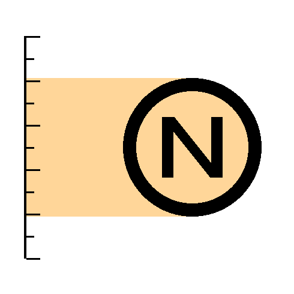

# neje

Free software for the **NEJE DK-8-KZ** laser engraver, for Linux (and Windows).
It replaces the abandoned Windows-only program NEJE V3.6: prepare a picture, some text or a
G-code drawing, send it to the engraver and run the job, from a window or from the terminal.

[Leggilo in italiano](README.it.md)


## Status

| Part | State |
|---|---|
| Image preparation (shrink, grey, Otsu, NEJE dithering, 1-bit BMP) | same bytes as the reference implementation on 21 000+ cases |
| Commands and messages of protocols V10, V20, V21, V30 | same bytes as the reference implementation |
| Detection, erase, upload, start, progress, end of job | tested against the built-in virtual engraver |
| Print modes (split in jobs, line art) and time estimates | same cuts and times as the reference tool; the split was checked on a real machine with that tool (estimated 143 s, took 148 s, the parts lined up) |
| A real DK-8-KZ (V10 firmware) | `detect`, `reset`, `upload`, `box`, `center` and `engrave` in line-art mode (three jobs in a row, 133 s against 129 estimated) worked on one machine. Not tried there yet: the window, `pause`, `forward`/`backward`/`redo`, `move`, `monitor`, and a split whose cut crosses a filled shape (see [docs/PROTOCOL.md](docs/PROTOCOL.md)) |
| Windows | built and tested by the CI (no serial port there); never tried with an engraver |

The DK-8-KZ engraves 490 × 490 pixels. The manual says 0.075 mm per pixel (36.75 mm); on the
machine measured here a pixel is 0.068–0.070 mm, so the area is about 34 × 34 mm.

## Laser safety

- The laser diode (405 nm) glows at low power **as soon as the 5 V supply is plugged in**:
  wear the protective goggles whenever the machine is powered.
- `start`, `engrave`, `box`, `forward`, `backward` and `redo` switch the laser on. The
  program asks for confirmation first: goggles on, material under the head, nothing
  flammable nearby. Never leave a running job unattended.
- Power the engraver from a real **5 V supply**, not from the USB ports of the computer:
  with both cables on the PC the board restarted in the middle of long jobs. The program
  reports such a restart as an error instead of waiting for an end that never comes.
- `box` (the outline) repeats until you send `center`.
- `start` engraves the image stored in the machine, which survives power off: on a machine
  you have just plugged in it may be an old picture.
- This program never writes the firmware of the engraver.

## Installation

### Arch Linux (AUR)

```sh
yay -S neje        # builds from source
yay -S neje-bin    # prebuilt binaries
```

The package installs `neje`, `neje-gui`, the launcher and the udev rule.

### Other Linux distributions

Download `neje-<version>-linux-x86_64.tar.gz` from the
[Releases page](https://github.com/deddroid/neje-rs/releases/latest), unpack it and run
`./install.sh` (installs into `~/.local`, no root). To build from source instead you only
need a Rust toolchain (1.88 or newer):

```sh
git clone https://github.com/deddroid/neje-rs
cd neje-rs
./install.sh            # builds and installs into ~/.local (no root)
./install.sh --udev     # also installs the udev rule (asks for the sudo password)
./install.sh --uninstall
```

Without the graphical interface: `cargo build --release --no-default-features`.

### Windows

Download `neje-<version>-windows-x86_64.zip` from the
[Releases page](https://github.com/deddroid/neje-rs/releases/latest) and unpack it: `neje.exe`
is the command line, `neje-gui.exe` the window. Windows needs the driver of the engraver's
USB converter (CH340): Windows Update usually installs it by itself; otherwise get `CH341SER`
from [WCH](https://www.wch-ic.com/downloads/CH341SER_EXE.html). The Windows build has not
been tried on a real machine.

### What it needs from the system

Nothing has to be installed next to the program: its fonts are built in, and on Linux the
driver of the engraver's USB converter (CH340, `1a86:7523`, kernel module `ch341`) is part
of the kernel, so the engraver shows up as `/dev/ttyUSB0`.

Two things belong to the system and can be missing. The window shows a banner when it finds
one, with a button that fixes it (it asks for the administrator password); `neje doctor`
does the same check in the terminal and `neje doctor --fix` the same fix.

- **Permission to open the port.** The port belongs to root and to a group (`uucp` on Arch,
  `dialout` on Debian and Ubuntu). The udev rule
  [packaging/linux/70-neje.rules](packaging/linux/70-neje.rules) gives access to the user
  logged in at the computer; the AUR packages install it.
- **Driver not bound to the converter.** Rare: the module is not loaded, or `brltty` (a
  braille service some distributions install by default) took the converter for a braille
  display.

The file dialogs of the window are those of the desktop (`xdg-desktop-portal`, present on
KDE Plasma and GNOME); without it, drop the files on the window or pass them on the command
line.

## Use

### Window

```sh
neje-gui                 # or the "NEJE Engraver" launcher
neje-gui photo.jpg       # open a picture or a G-code file at start-up
```

Open a picture (or drop it on the window), choose the conversion, connect, send the image,
then start. The red trace on the preview follows the positions reported by the engraver.

### Terminal

```sh
neje doctor                              # is anything missing on this system?
neje ports                               # list the serial ports
neje detect                              # find the engraver
neje preview photo.jpg -o preview.png    # what would be engraved, no machine needed
neje preview photo.jpg --mode dither     # NEJE dithering, for photos
neje preview --gcode examples/rosette.nc --fit --text "NEJE" --size 40
neje upload photo.jpg                    # erase the memory and send the image
neje engrave photo.jpg --burn 30         # send, then engrave (asks for confirmation)
neje engrave logo.png --print-mode split # several jobs, one after the other
neje engrave logo.png --print-mode line --stroke 2
neje start --burn 30                     # engrave the image already in the machine
neje pause                               # Ctrl+C during "engrave" also pauses
neje center | home | move left 5 | box | set-burn 40 | monitor
```

`neje --help` and `neje <command> --help` list every option. Useful ones:

- `--port /dev/ttyUSB0`: skip the search (and let `pause`/`reset` through even when the
  firmware is too busy to answer);
- `--protocol v10|v20|v21|v30|auto`: the default is `v10`, the protocol of the DK-8-KZ.
  `auto` tries them all like the original launcher; avoid it on a V10 machine;
- `--lang en|it`: language of the messages (default: from the locale).

### Print modes

The firmware only engraves row by row: on every row the head runs from the first to the
last black pixel and crosses whatever empty space lies in between. It has no "laser on" or
"go to X, Y" command, so the program cannot draw along a path; it can choose what to send.
Pick the mode in the strip under the preview, or with `--print-mode`; `neje preview` prints
the estimated time of all three for your image.

| | Mode | What it does |
|---|---|---|
|  | **Single job** (`single`) 8:30 | The image is sent and engraved as it is, in one go. Orange: the empty space the head crosses on every row. |
|  | **Split in jobs** (`split`) 7:19 | The image is cut in vertical bands (blue lines), engraved one after the other, when the empty space no longer crossed (green) is worth more than one more upload, about 12 s. The bands line up on the piece: do not restart or switch off the engraver between them. |
|  | **Line art** (`line`) 1:53 | Shapes are reduced to their centre line and drawn with a stroke of 1 to 6 pixels (`--stroke`) instead of being filled: one pass per pixel of width. For drawings, text and logos, not for photos. Split in jobs when that is faster. |

The pictures are `examples/badge.png` at burn time 30 (line art with a 2 px stroke), made with
`neje preview examples/badge.png --print-mode split --plan-image plan.png`. Times come from
measurements on one DK-8-KZ: 2.5 ms + 0.5 ms × burn time per burnt pixel, 1.73 ms per white
pixel crossed, about 12 s per job for the upload and the start.

Splitting is only used with protocol V10, the one it was measured on.

### Trying it without the machine

```sh
neje simulate                    # prints the path of a virtual serial port
neje --port /dev/pts/N engrave photo.jpg --yes
```

The virtual engraver answers like the V10 (or, with `--sim-protocol v30`, the V30) firmware,
saves the image it receives and reports protocol mistakes such as data sent during the erase.

## How it was checked

- `cargo test`: unit tests of the library and end-to-end tests of the CLI and of the session
  against the virtual engraver.
- `tests/parity`: the Python prototype (itself checked bit for bit against the code of the
  original program) writes the SHA-256 of its output for thousands of inputs, and the Rust
  test recomputes them. See the header of [tests/parity.rs](tests/parity.rs).
- `NEJE_DEBUG=1` prints the raw serial traffic; `NEJE_GUI_SCREENSHOTS=<folder>` saves a
  screenshot of the window per theme and language.

## Known limits

- JPEG files: decoders differ by one level on a few pixels, so the result can differ by a
  few dots from the Python prototype and from the original program (which used the Windows
  decoder). Everything after decoding is identical. PNG, BMP and the others are exact.
- Text is drawn with the built-in Inter font (or the one given with `--font`) and a
  different font engine than the prototype: not the same pixels.
- PNG files with a transparent colour key in RGB mode, and 16-bit PNG files, are read
  slightly differently from the prototype.
- `move` shifts where the image lands by 8 pixels per step, and the machine has no limit
  switches: move a few steps at a time. `move down` often stalls on the DK-8-KZ.
- G-code is drawn at the nominal 0.075 mm per pixel: on a machine with a 0.069 mm pixel the
  drawing comes out about 8% smaller than its millimetres.
- Line art follows the centre of each shape: thick letters can lose their sharp corners.
- The time estimates come from one machine and count a fixed 3 s per job for the start,
  which really takes 1 to 5 s depending on where the first pixel is.

## Credits

- [deddroid](https://github.com/deddroid), who owns the engraver and ran the tests on it.
- Claude (Anthropic), which wrote the code with him.
- The protocol comes from the official NEJE V3.6 program, studied for interoperability, and
  was cross-checked with [EzGraver](https://github.com/camrein/EzGraver) and
  [nejemojo](https://github.com/sthysel/nejemojo).
- Fonts: [Inter](https://rsms.me/inter/) and
  [Rajdhani](https://github.com/itfoundry/rajdhani), SIL Open Font License
  (see [assets/fonts](assets/fonts)).

NEJE is a trademark of its owner; this project is not affiliated with it.

## License

[MIT](LICENSE). The fonts in `assets/fonts` are under the SIL Open Font License.
