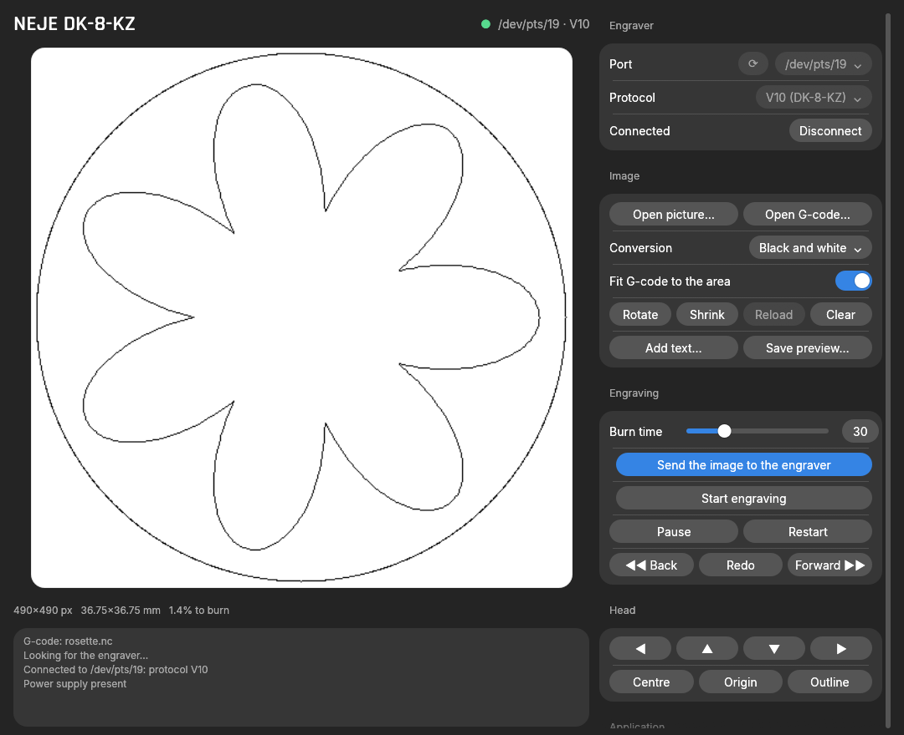

# neje

Free software for the **NEJE DK-8-KZ** laser engraver, for Linux (and Windows).
It replaces the abandoned Windows-only program NEJE V3.6: prepare a picture, some text or a
G-code drawing, send it to the engraver and run the job, from a window or from the terminal.

[Leggilo in italiano](README.it.md)



## Status

| Part | State |
|---|---|
| Image preparation (shrink, grey, Otsu, NEJE dithering, 1-bit BMP) | same bytes as the reference implementation on 21 000+ cases |
| Commands and messages of protocols V10, V20, V21, V30 | same bytes as the reference implementation |
| Detection, erase, upload, start, progress, end of job | tested against the built-in virtual engraver |
| A real DK-8-KZ | **not driven by this program yet**; handshake and movements were checked on one machine with the Python prototype it was ported from (see [docs/PROTOCOL.md](docs/PROTOCOL.md)) |
| Windows | builds are expected to work, never tried |

The DK-8-KZ has a 36.75 × 36.75 mm work area: 490 × 490 pixels of 0.075 mm.

## Laser safety

- The laser diode (405 nm) glows at low power **as soon as the 5 V supply is plugged in**:
  wear the protective goggles whenever the machine is powered.
- `start`, `engrave`, `box`, `forward`, `backward` and `redo` switch the laser on. The
  program asks for confirmation first: goggles on, material under the head, nothing
  flammable nearby. Never leave a running job unattended.
- `start` engraves the image stored in the machine, which survives power off: on a machine
  you have just plugged in it may be an old picture.
- This program never writes the firmware of the engraver.

## Install

Requirements: a Rust toolchain (1.88 or newer). On Arch/CachyOS nothing else was needed to
build; the window uses OpenGL and the desktop's own file dialogs.

```sh
git clone <this repository>
cd neje-rs
./install.sh            # builds and installs into ~/.local (no root)
./install.sh --udev     # also installs the udev rule (asks for the sudo password)
./install.sh --uninstall
```

The engraver's USB-serial converter (CH340, `1a86:7523`) is handled by the Linux kernel: it
shows up as `/dev/ttyUSB0`. To open it you need either the udev rule
([packaging/linux/70-neje.rules](packaging/linux/70-neje.rules), access for the user logged
in at the computer) or membership of the group that owns the port (`uucp` on Arch,
`dialout` on Debian and Ubuntu).

Without the graphical interface: `cargo build --release --no-default-features`.

## Use

### Window

```sh
neje-gui                 # or the "NEJE Engraver" launcher
neje-gui photo.jpg       # open a picture or a G-code file at start-up
```

Open a picture (or drop it on the window), choose the conversion, connect, send the image,
then start. The red trace on the preview follows the positions reported by the engraver.

### Terminal

```sh
neje ports                               # list the serial ports
neje detect                              # find the engraver
neje preview photo.jpg -o preview.png    # what would be engraved, no machine needed
neje preview photo.jpg --mode dither     # NEJE dithering, for photos
neje preview --gcode examples/rosette.nc --fit --text "NEJE" --size 40
neje upload photo.jpg                    # erase the memory and send the image
neje engrave photo.jpg --burn 30         # send, then engrave (asks for confirmation)
neje start --burn 30                     # engrave the image already in the machine
neje pause                               # Ctrl+C during "engrave" also pauses
neje center | home | move left 5 | box | set-burn 40 | monitor
```

`neje --help` and `neje <command> --help` list every option. Useful ones:

- `--port /dev/ttyUSB0`: skip the search (and let `pause`/`reset` through even when the
  firmware is too busy to answer);
- `--protocol v10|v20|v21|v30|auto`: the default is `v10`, the protocol of the DK-8-KZ.
  `auto` tries them all like the original launcher; avoid it on a V10 machine;
- `--lang en|it`: language of the messages (default: from the locale).

### Trying it without the machine

```sh
neje simulate                    # prints the path of a virtual serial port
neje --port /dev/pts/N engrave photo.jpg --yes
```

The virtual engraver answers like the V10 (or, with `--sim-protocol v30`, the V30) firmware,
saves the image it receives and reports protocol mistakes such as data sent during the erase.

## How it was checked

- `cargo test`: unit tests of the library and end-to-end tests of the CLI and of the session
  against the virtual engraver.
- `tests/parity`: the Python prototype (itself checked bit for bit against the code of the
  original program) writes the SHA-256 of its output for thousands of inputs, and the Rust
  test recomputes them. See the header of [tests/parity.rs](tests/parity.rs).
- `NEJE_DEBUG=1` prints the raw serial traffic; `NEJE_GUI_SCREENSHOTS=<folder>` saves a
  screenshot of the window per theme and language.

## Known limits

- JPEG files: decoders differ by one level on a few pixels, so the result can differ by a
  few dots from the Python prototype and from the original program (which used the Windows
  decoder). Everything after decoding is identical. PNG, BMP and the others are exact.
- Text is rendered with a different font engine than the prototype: same layout, not the
  same pixels.
- PNG files with a transparent colour key in RGB mode, and 16-bit PNG files, are read
  slightly differently from the prototype.
- Head movements (`move`): the machine has no limit switches and a step is not a pixel; move
  a few steps at a time.

## Credits

- Daniele ([deddroid](https://github.com/deddroid)), who owns the engraver and ran the tests on it.
- Claude (Anthropic), which wrote the code with him.
- The protocol comes from the official NEJE V3.6 program, studied for interoperability, and
  was cross-checked with [EzGraver](https://github.com/camrein/EzGraver) and
  [nejemojo](https://github.com/sthysel/nejemojo).
- Fonts: [Inter](https://rsms.me/inter/) and
  [Rajdhani](https://github.com/itfoundry/rajdhani), SIL Open Font License
  (see [assets/fonts](assets/fonts)).

NEJE is a trademark of its owner; this project is not affiliated with it.

## License

Not chosen yet: it will be set before the first public release.
